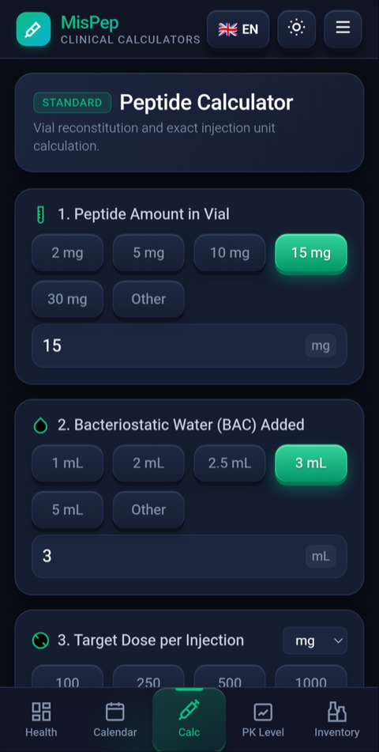
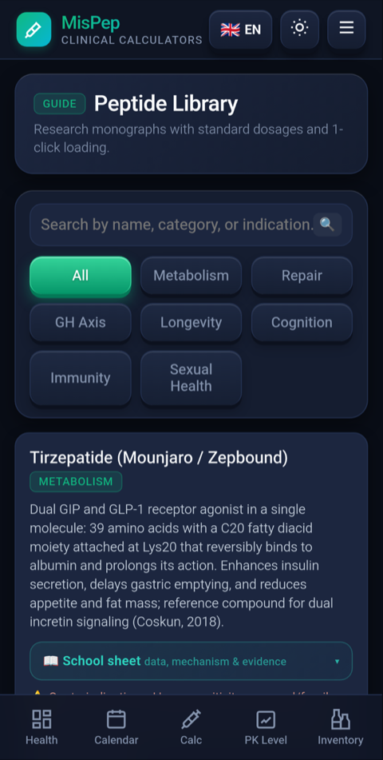
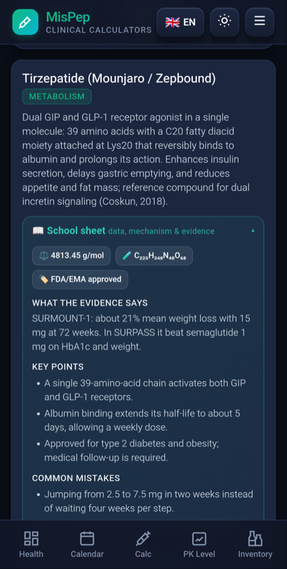
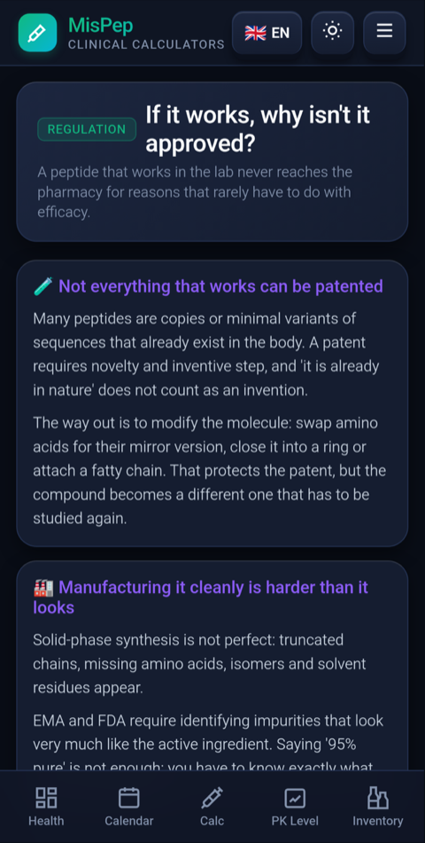
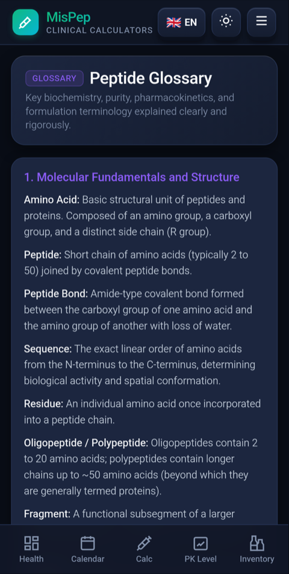
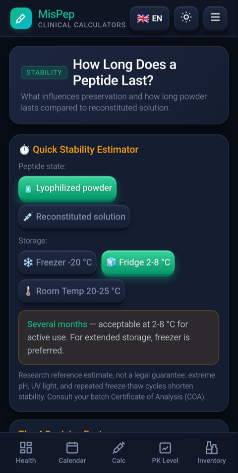

# MisPep - Aplicación Android

Aplicación Android nativa e híbrida (Java + WebView moderno) diseñada para el seguimiento clínico de protocolos de péptidos (GLP-1/GIP/glucagón como Retatrutida, Tirzepatida, Semaglutida), control de peso, evolución de tensión arterial y reconstitución.

## Características principales
- **Seguimiento de dosis y calendario:** Programación de inyecciones periódicas con alarmas del sistema.
- **Evolución del peso corporal e IMC:** Historial cronológico, métricas de progreso semanal y cálculo de IMC dinámico.
- **Control de tensión arterial:** Registro de sistólica/diastólica, pulso y seguimiento de medicación antihipertensiva.
- **Calculadoras de reconstitución:** Cálculo de unidades en jeringuilla/pluma, agua BAC, diluciones, mezclas y formatos nasales.
- **Simulador farmacocinético:** Modelo bicompartimental para visualización de niveles circulantes previstos.
- **Bilingüe (Español / Inglés):** Selector instantáneo de idioma sin recarga.
- **Privacidad y almacenamiento local:** Todos los datos se almacenan localmente en el dispositivo.


## Capturas de pantalla

Interfaz en inglés (la aplicación está disponible en español e inglés).

<table>
  <tr>
    <td align="center" width="33%"><br><sub><b>Calculadora de reconstitución</b><br>mg, mL y unidades de jeringa</sub></td>
    <td align="center" width="33%"><br><sub><b>Biblioteca de péptidos</b><br>42 monografías con filtros</sub></td>
    <td align="center" width="33%"><br><sub><b>Ficha de escuela</b><br>datos, evidencia y errores frecuentes</sub></td>
  </tr>
  <tr>
    <td align="center" width="33%"><br><sub><b>Por qué no se aprueban</b><br>patentes, CMC y regulación</sub></td>
    <td align="center" width="33%"><br><sub><b>Glosario</b><br>términos explicados en llano</sub></td>
    <td align="center" width="33%"><br><sub><b>¿Cuánto dura?</b><br>estabilidad según estado y temperatura</sub></td>
  </tr>
</table>

## Instalación

**Descargar el instalador:** [MisPep.apk (última versión)](https://github.com/Albertolia/mispep-android/releases/latest/download/MisPep.apk)

1. Descarga el APK en el móvil desde el enlace anterior.
2. Si Android lo pide, permite instalar apps de esta fuente: **Ajustes → Apps → Acceso especial → Instalar apps desconocidas**.
3. Abre el archivo descargado y pulsa **Instalar**. Si aparece el aviso de Play Protect, elige **Instalar de todos modos** (la app no está en Play Store).
4. Al abrirla, concede los permisos que quieras usar: notificaciones (recordatorios) y Health Connect (importar pesajes y tensión). Son opcionales.
5. Listo. No hace falta cuenta ni conexión: todos los datos se guardan en el propio móvil.

**Requisitos:** Android 7.0 o superior (API 24), unos 1 MB de espacio. Se puede actualizar encima de la versión anterior sin perder datos.

## Estructura del repositorio
- `src/`: Código nativo Android en Java (`MainActivity.java`, `BootReceiver.java`, interfaz `@JavascriptInterface`).
- `assets/`: Frontend web embebido (HTML5, CSS3, JavaScript SPA, Chart.js, i18n).
- `res/`: Recursos Android (iconos mipmap y drawables).
- `AndroidManifest.xml`: Declaración de componentes, permisos y consultas de intents.
- `build.py`: Pipeline de compilación automatizado vía CLI SDK (aapt2, javac, d8, zipalign, apksigner).
- `MisPep.apk`: Binario compilado y firmado listo para instalar.

## Compilación
Requiere Android SDK Tools (API 34) y JDK 17+:
```bash
python3 build.py
```
